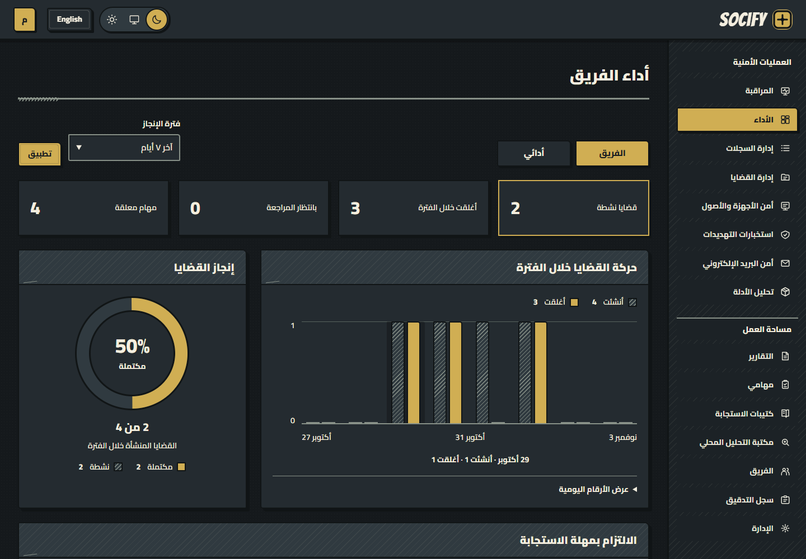
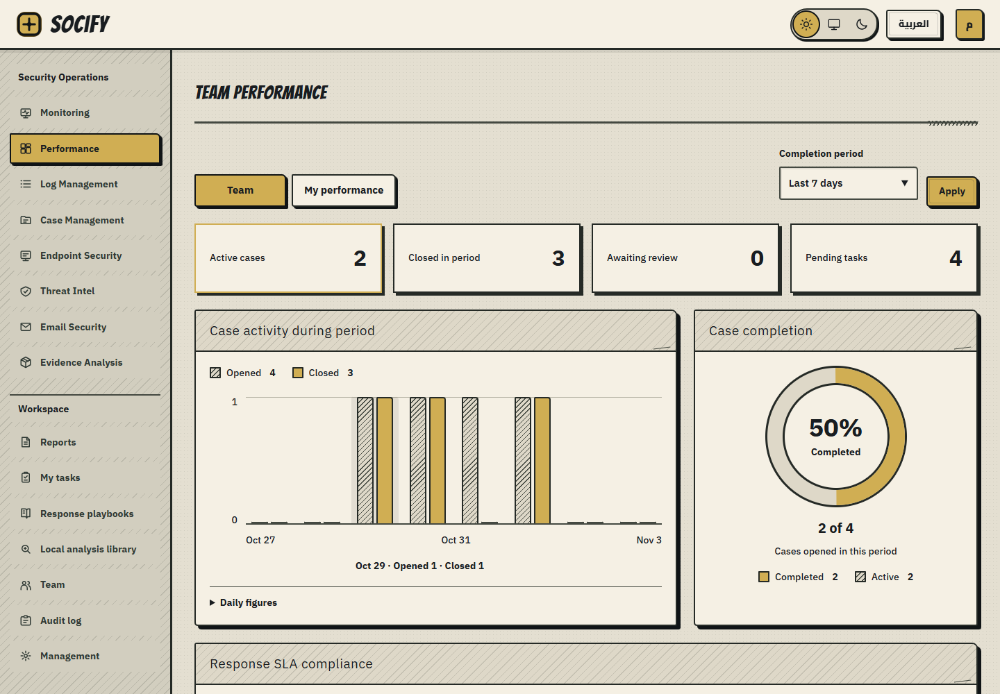
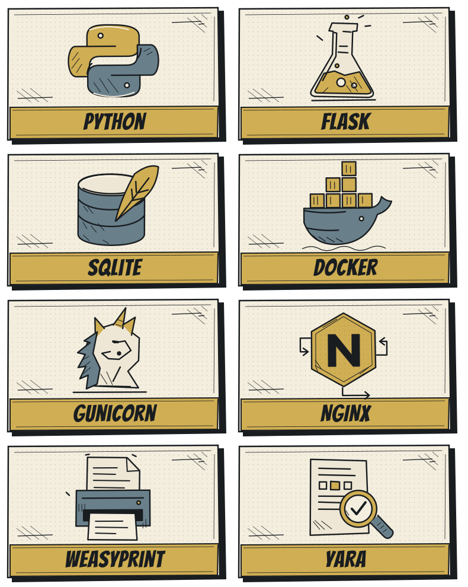

<h1 align="center"></h1>

<div dir="rtl">

منصة للتحقيق والاستجابة الأمنية: ارفع سجلاتك، راجع التنبيهات، وثّق الأدلة والقرار، ثم أصدر تقرير القضية. واجهة عربية وإنجليزية، مع وضعين داكن وفاتح.

[البدء](#البدء) · [المميزات](docs/features.md) · [دليل المحلل](docs/analyst-guide.md) · [التشغيل](docs/operations.md) · [الأمان](SECURITY.md)



<details>
<summary>عرض الواجهة الإنجليزية والوضع الفاتح</summary>



</details>

## من السجل إلى التقرير

| المرحلة | ما تنجزه |
|---|---|
| إدخال البيانات | معاينة الملفات، ضبط الحقول والوقت، استيراد السجلات أو استقبالها من موصل قضية |
| الكشف والفرز | قواعد كشف، تنبيهات مرتبطة بأدلتها، بحث وترشيح، وتوثيق نتيجة المراجعة |
| التحقيق | خط زمني، أصول ومؤشرات، علاقات، فرضيات، أسباب جذرية، وربط MITRE ATT&CK |
| التحليل | تحليل الشبكة ونتائج الأجهزة المستوردة، وفحص ساكن للملفات والبريد وقواعد YARA المحلية |
| الاستجابة | مهام ومسؤولون، كتيبات استجابة، تصعيد، مهل عمل، وإجراءات تصحيحية |
| المراجعة والتقرير | تقرير محفوظ بأدلته، مراجعة واعتماد، تصدير PDF وDOCX وHTML وMarkdown وJSON |
| إدارة الفريق | دعوات وأدوار وصلاحيات، إسناد العمل، رسوم أداء الفريق والفرد، وسجل تدقيق |

- التحليل مرتبط ببيانات القضية؛ إجراءات الاستجابة توثّق ما نفذه الفريق. لا تتصل المنصة بالأجهزة لتنفيذ أوامر أو عزلها.
- استخبارات التهديدات وGeoIP وتقارير السمعة تُستورد محليًا. سحب السجلات عبر HTTPS يحتاج مصدرًا مصرحًا وإعداد الشبكة.
- [قائمة المميزات والصيغ المدعومة](docs/features.md) توضّح نطاق كل خدمة.

## البدء

- للتشغيل الكامل: **Linux أو WSL، Python 3.12، وDocker**.
- شغّل الأوامر من مجلد المشروع. يُنشأ حسابك وبياناتك عند الاستخدام؛ لا توجد كلمة مرور مشتركة.
- لتجربة Codespaces اتبع [دليل Codespaces](docs/codespaces.md). للنشر المؤسسي استخدم [دليل التشغيل](docs/operations.md).

<div dir="ltr">

```bash
python -m venv .venv
source .venv/bin/activate
python -m pip install -r requirements.txt

docker build --target analysis -t socify-analysis .
bash scripts/start_analysis.sh
export SOCIFY_ANALYSIS_SOCKET=/tmp/socify-local-analysis-ipc/analysis.sock

python -m scripts.bootstrap_team --email owner@example.com --name "مالك المنصة" --team "فريق العمليات"
python run.py
```

</div>

1. افتح <http://127.0.0.1:5000> وسجّل الدخول بكلمة المرور التي أدخلتها عند إنشاء الحساب.
2. أنشئ قضية، وارفع سجلاتها، وتحقق من اكتمال الاستيراد.
3. افتح التنبيه وراجع أدلته، ثم أكمل التحقيق والمهام قبل اعتماد التقرير وإغلاق القضية.

## تقنيات التشغيل



| التقنية | الاستخدام |
|---|---|
| [Python](https://www.python.org/) و[Flask](https://flask.palletsprojects.com/) | التطبيق وواجهات التكامل |
| [SQLite](https://www.sqlite.org/) | البيانات، المعاملات، والبحث النصي FTS5 |
| [Docker](https://www.docker.com/) | عزل الخدمات والتحليل |
| [Gunicorn](https://gunicorn.org/) و[NGINX](https://nginx.org/) | تشغيل التطبيق ومدخل النشر |
| [WeasyPrint](https://weasyprint.org/) و[python-docx](https://python-docx.readthedocs.io/) | إخراج التقارير |
| [YARA](https://virustotal.github.io/yara/) | مطابقة قواعد فحص الملفات المحلية |

## هيكل المشروع

<div dir="ltr">

```text
SOCifyProject/
├── app.py                  # نقطة دخول خدمة التطبيق
├── run.py                  # التشغيل المحلي مع العمال
├── socify/                 # الحسابات، السجلات، الكشف، التحقيق، والتقارير
├── templates/              # صفحات الواجهة
├── static/                 # التنسيق، التفاعل، الخطوط، والهوية
├── data/                   # كتالوج ATT&CK المحلي
├── scripts/                # التشغيل، الحسابات، العمال، والنسخ الاحتياطي
├── deploy/                 # إعداد مدخل NGINX
├── docs/                   # أدلة الاستخدام والتشغيل ومواصفات API
├── tests/                  # اختبارات الوحدات والتكامل والمتصفح والأمان
├── fixtures/               # ملفات اختبار معزولة
├── .devcontainer/          # إعداد Codespaces
├── .github/workflows/      # التحقق الآلي
├── Dockerfile              # صور خدمات التشغيل والتحليل
└── docker-compose.yml      # ربط الخدمات ومساحات التخزين
```

</div>

## الأدلة

| احتياجك | الدليل |
|---|---|
| معرفة الخدمات والصيغ | [المميزات](docs/features.md) |
| إنجاز تحقيق وتقرير | [دليل المحلل](docs/analyst-guide.md) |
| توزيع العمل وقراءة الأداء | [إدارة الفريق](docs/teams.md) |
| التشغيل والنسخ والاستعادة | [دليل التشغيل](docs/operations.md) |
| تشغيل بيئة خاصة في GitHub | [Codespaces](docs/codespaces.md) |
| معالجة مشكلة | [استكشاف الأعطال](docs/troubleshooting.md) |
| إعداد الأمان وحدود الثقة | [دليل الأمان](docs/security-guide.md) · [نموذج التهديد](docs/threat-model.md) |
| التكامل مع المنصة | [مواصفات API](docs/api/openapi.yaml) |

## الترخيص

- [MIT](LICENSE).
- تراخيص المكونات والخطوط والبيانات في [إشعارات الأطراف الثالثة](THIRD_PARTY_NOTICES.md).
- للإبلاغ عن ثغرة، اتبع [سياسة الأمان](SECURITY.md).

</div>
