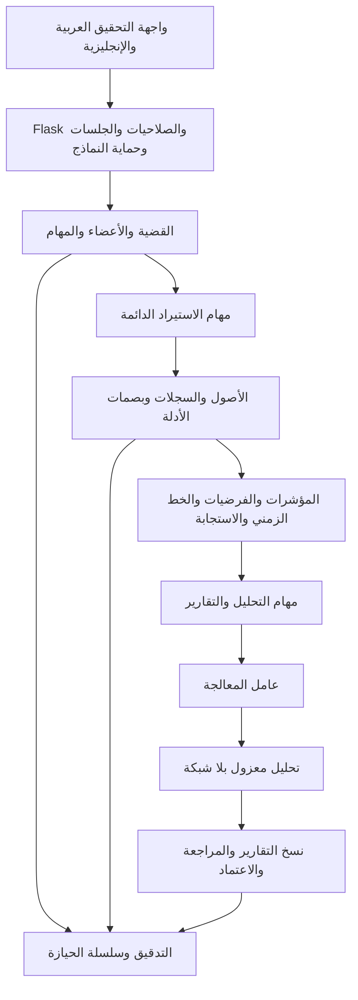

# هندسة منصة التحقيق

SOCify تطبيق Flask لإدارة القضايا والتحقيق في الحوادث وتحليل الأدلة وإصدار التقارير. يبدأ الاستخدام التشغيلي بقضية، وتُجرى عمليات الاستيراد والبحث والتحليل والتوثيق في نطاق قضية مصرح بها. قاعدة البيانات الحالية SQLite؛ قابلية نشرها وحدود الحمل تعتمد على البيئة والحجم ونتائج القياس الفعلية.

## تنظيم المنطق

| الملفات | المسؤولية |
| --- | --- |
| `socify/__init__.py`, `config.py`, `ui.py` | إنشاء التطبيق والإعدادات وصفحات مساحة العمل |
| `auth.py`, `security.py`, `operational.py` | الهوية والجلسات وMFA والصلاحيات ونطاق القضايا |
| `cases.py`, `autopsy_api.py`, `teams.py` | القضايا والسجلات والأعضاء والإسناد |
| `autopsy_ingestion.py`, `autopsy_pipeline.py`, `import_worker.py` | الاستيراد ومعالجة السجلات والمهام القابلة للاستئناف |
| `autopsy_chronology.py`, `autopsy_investigation.py`, `autopsy_workflow.py` | التسلسل الزمني والفرضيات ونطاق التحقيق وتوثيق القرارات |
| `autopsy_samples.py`, `autopsy_detection.py`, `autopsy_yara.py` | عينات الأدلة والكشف والتحليل المحلي |
| `autopsy_reports.py`, `autopsy_report_render.py`, `report_brand.py` | اللقطات الثابتة والمراجعة وتوليد صيغ التقارير |
| `analysis_transport.py`, `analysis_sandbox.py`, `autopsy_worker.py` | اتصال المعالجة المعزولة وحدود الموارد وحالة المهام |
| `db.py`, `schema.py`, `autopsy_schema.py` | اتصالات SQLite والترحيل وسلامة العلاقات |

## سلامة التحقيق

- يتحقق الخادم من مساحة العمل وعضوية القضية والصلاحية لكل قراءة وتعديل وتصدير؛ إخفاء عنصر في الواجهة ليس تصريحًا.
- تُحفظ الأدلة الأصلية وبصماتها، وتُسجّل تغييرات التحقيق كإصدارات وحركات حيازة وتدقيق.
- تُجهّز التقارير من لقطة ثابتة مع إصدار المصدر وسياسة المشاركة؛ لا تُعاد صياغة نسخة معتمدة عند تغير القضية.
- خدمة التحليل منفصلة عن قاعدة البيانات ومفاتيح التشفير، بلا شبكة، مع قيود للعمليات والذاكرة والوقت. غياب العزل المطلوب يمنع التنفيذ.
- لا ينفذ المتصفح نصوص الأدلة المستوردة. تُعرض القيم كنصوص، وتظل الأدلة والمعرفات والأوقات محفوظة دون ترجمة محتواها.
- الاستيراد والتحليل والتقارير يستخدمون مهام دائمة مع حالات ومحاولات وإلغاء واستعادة، ولا يعتمدون على بقاء طلب HTTP مفتوحًا.

## توافق البيانات

بعض منطق الإصدارات السابقة باقٍ لقراءة البيانات القديمة وترحيلها وللتحقق من التوافق. المسارات العامة للتدريب متقاعدة في الوضع التشغيلي، ولا تُعرض كهوية للمنصة أو قدرات تشغيلية. لا تُحذف الجداول أو الوحدات التي تعتمد عليها الترحيلات وسجلات القضايا القديمة لمجرد تقاعد واجهتها.

لإعداد النشر والمفاتيح والعامل المعزول والنسخ الاحتياطي راجع [دليل التشغيل](operations-v3.md)، ولضوابط الأمان راجع [دليل الأمان](security-guide.md).
