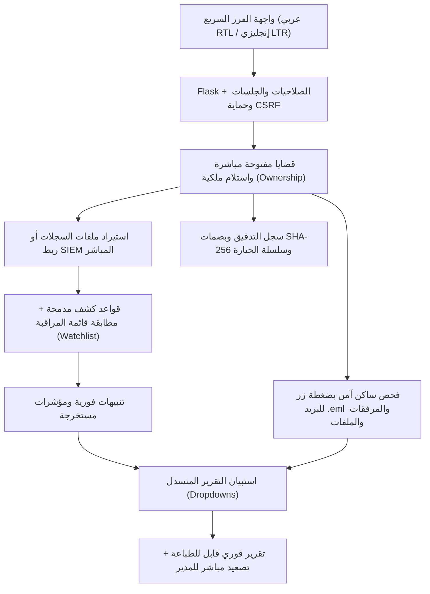

# معمارية SOCify Tactical Workbench (V6)

SOCify تطبيق Flask خفيف وسريع يعمل كـ**«سكين سويسرية»** للفرز والتحقيق الأمني الأولي وإصدار التقارير الفورية. صُمم ليختصر وقت المحلل والمحقق والمدير من لحظة وصول سجلات SIEM أو رسالة بريد/ملف مشبوه إلى لحظة طباعة التقرير النهائي وتصعيده، مع الحفاظ على سلامة الأدلة وعزل مساحات العمل وسجل التدقيق. قاعدة البيانات الافتراضية SQLite بنمط `WAL` عالية الأداء، مع قابلية التوسع المؤسسي.

## تنظيم الوحدات البرمجية

| الملفات | المسؤولية |
| --- | --- |
| `socify/__init__.py`, `config.py`, `ui.py` | إنشاء التطبيق والإعدادات ومسارات صفحات الفرز ومساحة العمل |
| `auth.py`, `security.py`, `operational.py` | الهوية والجلسات وMFA والصلاحيات ونطاق رؤية واستلام القضايا |
| `cases.py`, `autopsy_api.py`, `teams.py` | إنشاء القضايا المباشر واستلام الملكية والسجلات وإسناد المهام |
| `sources.py`, `ingestion.py`, `autopsy_ingestion.py` | موصلات SIEM واستيراد وتطبيع 8+ صيغ سجلات والبحث النصي السريع |
| `detection.py`, `autopsy_detection.py`, `sigma_subset.py` | محرك القواعد المدمجة وتقييم التنبيهات الفوري ودعم Sigma المحلي |
| `autopsy_email.py`, `autopsy_samples.py`, `autopsy_static_analysis.py` | الفحص الساكن الآمن لرسائل `.eml` والمرفقات والملفات دون تشغيلها |
| `autopsy_intel.py` (+ قائمة المراقبة في V6) | قوائم مراقبة الإيميلات والـ IPs والمؤشرات المشبوهة والإثراء المحلي |
| `autopsy_reports.py`, `autopsy_report_render.py`, `report_brand.py` | التقارير الموجهة القابلة للطباعة الفورية واللقطات الموثقة والتصعيد للمدير |
| `db.py`, `schema.py`, `autopsy_schema.py` | اتصالات SQLite (`WAL`) والترحيلات وسلامة العلاقات |

## مبادئ الأمان وسلامة الفرز

- **عدم التشغيل مطلقاً (`Never Executed`):** تُفحص الرسائل والمرفقات والملفات كبيانات ثنائية/نصية ساكنة فقط؛ لا يتم تشغيل أي ملف أو فتح أي رابط خارجي تلقائياً.
- **حماية المتصفح:** لا ينفذ المتصفح أي نصوص مستوردة من السجلات أو رؤوس البريد؛ تُعرض القيم كنصوص آمنة مع الحفاظ على المعرفات والبصمات والأوقات بلغتها الأصلية دون ترجمة تحرّف الدليل.
- **تحقق الخادم الكامل:** يتحقق الخادم من مساحة العمل والصلاحيات في كل قراءة وتعديل وتصدير.
- **حفظ الأصل:** يُحتفظ بأصل الملفات والسجلات المستوردة مع بصمة `SHA-256` وسجل تدقيق لكل إجراء.

للاطلاع على تفاصيل مراحل التطوير الجارية راجع [خطة تطوير V6](v6-plan.md).
