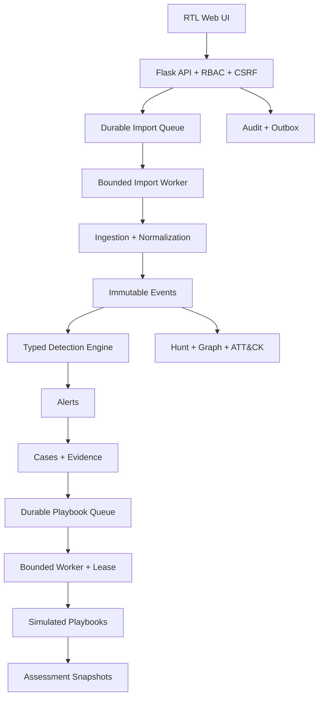

# الهندسة وقرارات التصميم

## حدود النظام

SOCify تطبيق Flask أحادي قابل للفصل منطقيًا إلى وحدات خدمة، مع SQLite في النسخة الحالية. قرار SQLite مناسب لمختبر فردي أو فريق صغير؛ النشر المتعدد الكثيف يحتاج ترحيل طبقة التخزين إلى PostgreSQL وعامل مهام منفصل دون تغيير عقود API.

## مبادئ الثقة

- الخادم مصدر الحقيقة؛ الواجهة لا تقرر الصلاحية أو النتيجة.
- `workspace_id` حد العزل الأول، وملكية `training_run_id` حد العزل الثاني للمتدرب.
- الأحداث raw evidence غير قابلة للحذف من API؛ التغيير التشغيلي يضاف كسجل جديد أو metadata مدققة.
- كل تعديل حساس يستخدم transaction وسجل تدقيق وcorrelation ID.
- محرك القواعد parser typed بميزانية عمق وعدد شروط، ولا يستخدم `eval` أو SQL من المستخدم.
- Playbooks تكتب إلى `response_simulation_state` فقط ولا تستدعي شبكة أو Shell أو مزودًا خارجيًا.

## تدفق البيانات

1. يقرأ المستورد الملف ضمن حد الحجم ويحدد parser من محتوى محدود وامتداد معروف.
2. ينتج Normalized Event بوقت حدث UTC ووقت إدخال مستقل وhash ومصدر.
3. يمنع مفتاح idempotency إعادة الإدخال، ثم يقيّم محرك القواعد داخل transaction.
4. يحفظ Alert مستقلًا مع rule version وevidence وtrace وdedup key.
5. ينشر outbox إشعارًا يمكن استئنافه عبر SSE باستخدام `Last-Event-ID`.
6. يربط المحلل Alert وEvents بقضية؛ الأدلة تحصل على SHA-256 وسلسلة نشاط.
7. عند اكتمال Training Run يحفظ Assessment Snapshot ومدخلات الحساب وبصمته.

تستخدم نوافذ الكشف `event_time` بعد تحويل ISO 8601 ذي المنطقة الزمنية أو Unix إلى UTC، ولا تستخدم وقت وصول الطلب لبناء التسلسل. يحسب watermark كأعلى `event_time` داخل workspace وTraining Run؛ يرفض كل Rule حدثًا يتجاوز `allowed_lateness_seconds` ويسجل suppression. تقرأ النافذة حتى وقت الحدث الحالي فقط، وترتب بالتوقيت ثم المعرف، ويمنع dedup key المبني على Rule version والمجموعة ومعرفات الأحداث احتساب النافذة نفسها مرتين. سجلات Syslog القديمة بلا منطقة تعلن `current_year_utc` في المعاينة والدليل الخام.

## ADR

| القرار | النتيجة | السبب |
|---|---|---|
| ADR-001: SQLite الآن | مقبول بحدود موثقة | تشغيل من المتصفح وبيئة مختبر صغيرة مع WAL وforeign keys وbusy timeout |
| ADR-002: Application factory + Blueprints | مقبول | فصل الوحدات واختبارها دون خادم خارجي |
| ADR-003: Server sessions + DB revocation | مقبول | إلغاء جلسات وتدويرها بعد تغيير كلمة المرور |
| ADR-004: Typed JSON DSL | مقبول | قابلية تفسير ومنع تنفيذ الكود والاستعلامات الحرة |
| ADR-005: SSE + durable outbox | مقبول | استئناف بسيط ومعرفات ثابتة دون فقد أثناء إعادة الاتصال |
| ADR-006: Simulated SOAR only | إلزامي | يمنع الأثر على أجهزة أو حسابات أو Firewalls حقيقية |
| ADR-007: Full STIX loader + offline subset | مرحلي صادق | تعمل التقنيات الأساسية offline؛ قبول التغطية الكاملة يتطلب تحميل Bundle MITRE الرسمي بالإصدار المثبت |
| ADR-008: Durable simulated-response worker | مقبول | عملية الويب تضيف المهمة فقط في الإنتاج؛ عامل محدود يملك lease ويستعيد المنقطع وينفذ كل أثر وحالة خطوته في transaction واحدة |

## حدود معروفة

- استيراد الإنتاج ينفذه عامل مستقل محدود مع lease، و100-row checkpoints، وbackpressure واستعادة من آخر checkpoint بعد انقضاء الملكية. الاستلام at-least-once وتمنع مفاتيح الحدث إعادة إدخال الصف المقبول.
- Playbook jobs تعمل بعامل مستقل محدود بعملية واحدة لكل instance. الاستلام at-least-once؛ أثر قاعدة البيانات وحالة الخطوة exactly-once ضمن transaction محلية، ويمنع `effect_key` تكرار هوية الأثر. لا توجد آثار أجهزة أو شبكة خارجية.
- الرسم Vanilla SVG بحد 1000 حدث وجدول بديل؛ التجميع الضخم يحتاج Cytoscape/WebGL.
- مصدر ATT&CK المضمن يغطي تقنيات السيناريو المرجعي. أداة STIX ترفض ادعاء الاكتمال إذا كان Bundle أقل من 600 تقنية.
